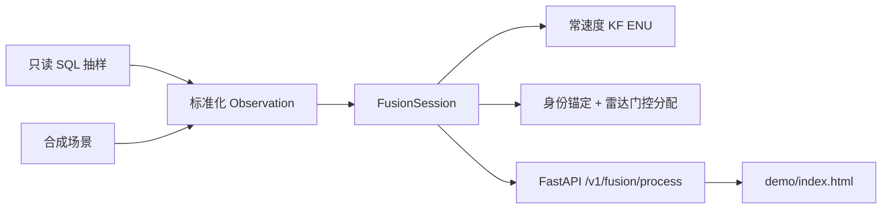

# 设计：三源融合 MVP

## 架构

## 关键决策

| 项 | 选择 |
|---|---|
| 坐标 | 固定原点横墨卡托平面米；高度不参与三维门控 |
| 滤波 | 水平 CV-KF；噪声未标定（`noiseCalibrated: false`） |
| 状态 | 单进程、session 串行；重启新 epoch |
| 幂等 | `batchId`+内容哈希缓存 |
| 主源 | 新鲜 RID > 当前更新来源 |

## 模块

- `src/fusion_mvp/mapping.py`：字段映射与降级
- `src/fusion_mvp/engine.py`：关联/生命周期/幂等
- `src/fusion_mvp/api.py`：HTTP
- `scripts/inspect_insert_dump.py`：流式体检（禁止整文件入内存）
- `scripts/replay_real_samples.py`：真实抽样回放

## Flow2Spec 实际使用

- CLI `flow2spec version/config/doctor` 已核验；无 MCP 业务工具
- 任务树：`.task/chriswork400/`（`f2s-req-plan`）
- 知识库仅有流程主题，无业务融合 stock-docs；规格落在 `docs/` 与 `.Knowledge/req-docs/` 副本
