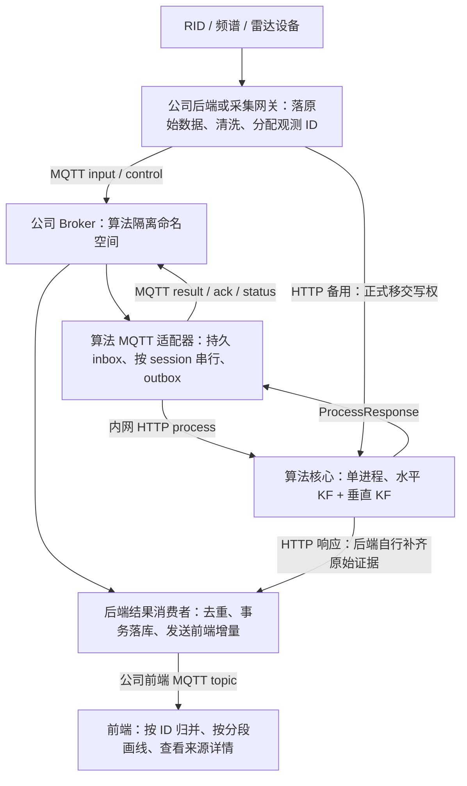
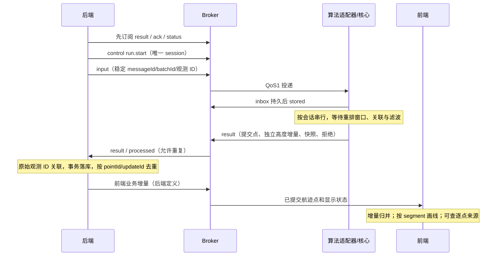
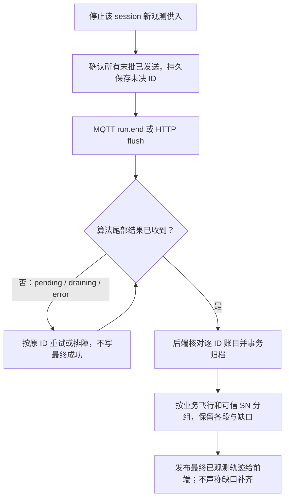

# 实时调用、结束与前端绘图

## 1. 实际调用架构

现有适配器内部仍调 HTTP；MQTT 不会让 KF 天然变快。MQTT 提供解耦与队列，处理能力仍取决于计算、排队和消费速度。设备到后端的接入协议、后端到浏览器的 MQTT/WebSocket 是公司系统负责；算法适配器当前使用 MQTT 3.1.1 TCP，不提供浏览器 WebSocket Broker。

## 2. 三种 topic 不得混用

- 设备原始 topic：公司已有，算法不直接订阅所有设备原始 JSON。
- 算法 topic：`fusion/v1/{tenantId}/{siteId}/{input|control|result|ack|status}`，本包定义。
- 前端业务 topic：由后端/前端约定，如 `company/uav/fusion/...`，只是建议命名，当前算法未定义该 topic/schema。

公司后端订阅算法 result，可靠落库后再发送前端。不要把前端业务消息回发到 input 形成反馈环。前端仅订阅其有权访问的业务范围；不能用任意 tenantId/sessionId 访问别的租户。

## 3. 实时正常流程

### 具体步骤

1. 为每个站点/空间融合域建立一个长期 session，包含同时可相互关联的设备/目标；**不要每个点建 session，也不要按源各建一个 session**，否则不同来源永远见不到彼此。不同站点/租户必须隔离。明确什么业务事件代表 session 结束。
2. 后端将租户/站点/业务 run/flight 与算法 sessionId 做持久映射。当前算法请求没有强类型 `flightId` 字段；不能把未实现字段塞入 payload 后以为核心会处理。
3. 规范化为 rid/spectrum/radar；同一台设备 detectorId 稳定，雷达局部号用原设备目标 ID。RID/频谱 aircraftId 按公司 id 映射；缺可信 SN 的雷达为 null。
4. 每条测量生成稳定 observationId（建议使用采集系统事件主键；没有则为采集事件分配并落库 UUID）。同 SN 的连续点必须有不同 observationId；同一点重发保留同 ID。批次/messageId 同理，全球唯一包含租户/站点/运行前缀更稳妥。
5. 保留真实 measurementTime/receivedAt；统一带时区，转换 UTC。实时处理的 processingTime 由适配器在队首首次执行时生成；不是由浏览器随意改时间。NTP 偏差/传输时延超重排窗会导致 late/future 拒绝。
6. 先以每 100–200ms 一个小批（按实际业务速率调整）开始联调，不是性能承诺；同 detectorId+scanId 的同扫多目标尽量整组供入。同一 session 保持单逻辑生产顺序，避免多个设备线程乱发处理时钟。
7. 总线确认 PUBACK 只证明协议送达；stored 表示入持久 inbox；processed 表示核心响应进入 outbox；result 到后端落库是另一个里程碑。
8. 2s 重排窗内 result 可能没有 trajectoryUpdates，属于正常缓冲；持续数据/idle tick 或 flush 后释放。不能据首个空数组判失败。
9. 每次 result 均检查 payload.error 和 rejected，失败不可当空成功。后端原始测量表、结果消息表、提交点表、独立高度表与关联证据表分层持久化。

## 4. 后端落库建议（业务设计，不是算法已有数据库表）

| 表/记录 | 推荐唯一键 | 用途 |
|---|---|---|
| raw_observation | tenant+site+session+observationId | 原始输入、清洗版本、原始/规范时间和坐标 |
| fusion_message | tenant+site+session+messageId | 重发去重、原完整消息、接收状态 |
| fusion_point | tenant+site+session+epoch+pointId | 水平提交历史，不能被快照预测覆盖 |
| altitude_update | tenant+site+session+epoch+altitudeUpdateId | 独立高度增量；非额外 XYZ 点 |
| point_evidence | 上述点键+observationId+role | 查询这一点具体用了哪些原始来源 |
| fusion_track | tenant+site+session+epoch+fusionId | 最新展示状态、SN、sourceTracks、aliases |
| business_flight_segments | 公司 flightId+segment 引用 | 最终按业务飞行归档，跨段仍保留缺口 |

后端事务可同时写消息去重记录、点/高度/来源、待转前端 outbox，再确认业务消费。公司接收实现必须自行验证持久后确认与断线重发；示例 receiver 只是联调落库器，不等于公司生产消费者已完成。

## 5. 前端到底画哪个数组

| 算法字段 | 后端/前端处理 |
|---|---|
| trajectoryUpdates | 按 pointId 幂等追加正式融合历史；按 stateTime 排序、按 fusionId+trackSegmentId 分组；这是融合实线依据 |
| altitudeUpdates | 单独保存并联动高度曲线/详情；没有 XYZ，不补造经纬度，也不把最新高度覆盖所有旧点 |
| tracks | 最新状态/当前位置/预测 marker，按 displayStateTime 展示；不能每帧拿 snapshot 连成新的实测历史 |
| sourceTracks | 候选/确认绑定关系，不等于每个历史点都用了所有这些来源 |
| observationIds / altitudeObservationIds / evidence | 逐点来源；详情里显示对应原始 SN/局部号、经纬度/海拔/时间，不猜测关联 |
| aliases / alias 事件 | 已有融合 ID 别名关系；保存映射以便查询，不自动跨段画线 |
| rejected / error / qualityFlags | 保留告警与质量提示，不能被地图漂亮效果掩盖 |

二维：按经纬度画提交历史；三维：仅有有效海拔且基准兼容的点进入 MSL 轴。未知/过期高度不填 0。不同目标、不同段、明确缺口不能实线相连；预测另用虚线/专门图层。归属标签用可信 SN + fusionId；雷达仅局部号；不把若干匿名 fusionId 数量当成无人机台数。

同一时间的 RID/频谱/雷达点不一定代表同一架飞机；同一文件/同一时间窗也不代表三源同机。现场真值验收需专门安排已知飞行和设备覆盖，不能用数据库混合数据自动得出融合精度。

## 6. HTTP 实时与 MQTT 备用切换

HTTP POST `/v1/fusion/process` 的请求/响应见字段表和 examples。省略 fusionProfile 会进入 legacy，本次必须显式 `multisensor-3d-v1`。同 session 不支持一会儿二维、一会儿三维或混用 realtime/replay。

MQTT→HTTP 同 session 切换：先暂停后端向该算法 input 的新供入，记住最后确认/未完成 ID；确认适配器队列边界，GET write-owner；POST handover 指定 fromOwner、expectedGeneration；取得新 generation 后，所有 HTTP process 带 `X-Fusion-Channel:http`、`X-Fusion-Write-Generation:<新值>`。恢复 MQTT 时做反向移交并让适配器更新该 session 代际。不能靠改 URL 同时双写，也不能 reset 来伪装无缝切换。

HTTP 响应没有适配器新增 evidence 字段；后端按 ID 回查自己保存的原始观测。不要因为走 HTTP 备用就丢来源详情。

## 7. 飞行/会话结束流程

一个 session 若含多架无人机，某一架飞机离场不应立即给整个 session 发 run.end。先按 trackStatus/lastObservedAt 在业务层标记该飞行结束；只有该空间会话整体停止供入才 end。业务后端的飞行定义与算法 session 生命周期必须先对齐。

run.end 看到 ack.status=drained、detail.action=run.end 且账目无未决，再核对后端已收到对应 result。QoS1 result 与 ack 分 topic 不应当成一个原子事务；drained 不证明公司后端已经落库。独立高度/事件同样要归档。reset 是丢状态操作，不是正常 end，不在还需查询/回退时自动调用。
