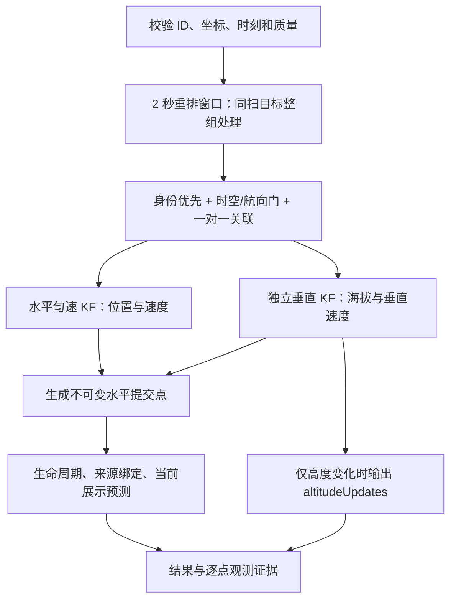

# 算法逻辑、稳定性、并发和运行边界

## 算法处理逻辑

1. 输入先做有限数、经纬度范围、0/0占位、具体 detectorId、带时区时刻等检查。拒绝原因通过 rejected/events 返回，不等同整个批次都失败。
2. watermark 是已经提交的事件时间前沿。窗口内乱序可重排；落后前沿的测量会 late_after_frontier。不能期待算法无限等待迟到设备。
3. 同 SN 的唯一门内候选优先，SN 不是免检通行证；冲突/歧义要记录。匿名目标按时空、航向等条件一对一分配；同 detectorId+scanId 的多个目标不能抢同一融合目标。无源局部号时可生成局部编号，但不能当可信设备身份。
4. 已确定的多源观测用于水平状态估计，保持同一实体融合 ID 的连续性；主源优先顺序 RID→频谱→雷达，存在鲜度和有效性条件。不能概括成所有时刻都只用 RID，也不能声称每个点都平均了三源。
5. `multisensor-3d-v1` 沿用二维水平位置/速度 KF，另有 `[altitude, verticalSpeed]` 一维匀速 KF；输出 XYZ，但**关联仍非全耦合三维距离模型**。垂直使用有效 MSL、创新门和过期重初始化；仅高度观测不推进水平时钟/不让 lost 变 tracked。
6. 当前行为体现有限状态预测：4s 内 coasting、12s 后 lost、30s 后 terminated（实际代码按配置阈值判断）；水平展示预测上限约4s。短时 lost 恢复要通过已有身份/运动门；目标终止后可能新建 fusionId。这里不是任意长缺口重识别保证。
7. tentative 候选可在满足多时刻接近等条件时做受限合并，aliases 反映别名；不是事后按 SN 拼接任意段。commit 是实际状态更新历史，预测快照不是额外实测点。
8. objectClass 透传/累积已有上游类别，不是本服务运行鸟类分类模型。unknown/conflict 如实保留。

## 已审工程默认值：不能当现场精度或容量承诺

| 参数 | 当前值 | 意义 |
|---|---|---|
| reorder_window_s | 2s | 窗口水位延迟，不是全链路 SLA |
| horizontal std RID/频谱/雷达 | 8 / 25 / 40 m | 未标定测量标准差，实际 R=std² |
| gate_m | 80m | multisensor 空间门工程值；不是精度保证 |
| heading_gate_deg | 70° | 有效运动航向门 |
| confirm_distinct_times / bind_confirm_times | 3 / 2 | 目标确认/来源绑定不同时间证据数 |
| closed_scan_reject_s | 4s | 已关闭同扫的保护窗 |
| coast/lost/terminate/predict | 4 / 12 / 30 / 4s | 生命周期与展示预测界限 |
| altitude std RID/频谱/雷达 | 5 / 15 / 25 m | 垂直测量标准差，未现场标定 |
| altitude_innov_m / horizon | 80m / 4s | 垂直创新门/缺测可预测时长 |
| max_observations_per_request | 5000 | 单次实时/公开 process 硬限制，不建议每次顶满 |
| max_replay_observations | 20000 | 单离线 replay 输入上限 |
| max_tracks | 400 / session | 活跃算法目标约束，不等于可用 400 台目标 SLA |
| committed_history_cap | 80 / track | 快照只留近期提交历史；全程需后端增量落库 |
| max_seen | 20000 | 观测 ID 记忆有界，不是永久去重承诺 |
| max_cache / max_idempotency_ids | 200 / 24576 | 批次完整响应缓存/幂等 ID 窗口容量 |
| idempotency_ttl_s | 1800s | 幂等窗口；过期后需后端自己的业务幂等 |
| session_idle_ttl_s | 3600s | 按空闲回收；不是永久保存 session |
| TASK008_MAX_INBOX | 50000 | 活跃适配器 inbox 容量，不是吞吐量 |
| TASK008_MAX_SESSION_WORKERS | 4 | 同一适配器最多四个会话工作线程 |
| TASK008_IDLE_TICK_S | 2s | 空闲推动水位/状态，不是设备心跳 |

更多内部去重、绑定、证据队列也有上限。批次可能接受入队，随后某条观测被拒绝；rejected 必须核对，不能只看 HTTP 200 或 stored。超大 MQTT 输入超过适配器8,000,000B会在网络入口被丢弃/协议确认，未保证应用 reject，应在后端主动限制到已确认 Broker 的报文预算内，不要测试到入口上限才算流控。

**工作台 event 分页的 262144B 预算/分片是调试页面接口限制，不等同公司正式 MQTT result 已实现透明分片。** 正式 Broker 最大报文需现场确认；MQTT result 本身不自动按该预算分页。正常使用小批次并限制 rawRef 大正文，原文由后端持久保存。

## 部署与并发

- 核心会话、写权 owner 和 generation 在单个 Python 进程内存中；同 session 有 RLock，按序处理，多个 session 可由 FastAPI 线程执行。CPU/锁/队列决定实际吞吐，四线程不等于四倍计算性能。
- **核心必须 `--workers 1`，不使用 --reload。** 不能直接 gunicorn/uvicorn 多 worker 或负载均衡随机把同 session 打到不同副本。
- 一套适配器仅服务配置的 tenant/site，固定 topic。多站点优先一个站点/融合域一套隔离实例；每套 core、adapter、存储、clientId 唯一。MQTT 身份与 HTTP session 参数不是完备的用户认证/资源限额系统，租户权限仍由网关和 Broker ACL控制。
- 横向扩容需会话一致性路由、单 owner、worker 故障恢复/持久状态等额外设计，当前未验收。不要通过简单复制 adapter 去同时订阅相同会话 input 扩容。
- 当前 session 个数未见全局硬上限；后端不要任意创建无限 session，网关需限制新建速率和活跃会话。逐 session 的 max_tracks 并非整机上限。
- 大历史 replay 是同步 CPU/内存工作，不建议与繁忙实时核心并发争抢。正式批量离线可在独立实例调 replay；临时会话不会恢复在线 KF。相同硬件下容量需要实测。

## 可靠性语义

| 场景 | 当前行为 | 后端动作 |
|---|---|---|
| MQTT QoS1 重投 | inbox/messageId、结果消费者需去重 | 原 messageId/body 重发；不以新 ID 绕过幂等 |
| 同 ID 不同内容 | conflict | 保留原件、报警，修生产端，不能覆盖 |
| HTTP 超时/5xx | 适配器按原不可变 work item重试/退避，最终可能死信 | 检查 ack/status、原 ID 重试策略；不能无限堆队列 |
| inbox 落盘失败 | 扣留 QoS1 PUBACK | 告警磁盘/权限，恢复存储；不宣称已存 |
| Broker 发布未确认 | outbox 待重发 | 接收端按 messageId 幂等，监控积压 |
| capacity/backpressure | 不按业务完成确认 | 上游限速/持久排队，避免丢测量 |
| 核心重启/epoch 变化 | KF 内存丢失，适配器可能暂停并报告 state_recovery_required | 停供、保留未决ID、人工选择新 session/新 epoch 与回放归档；不能把 replay 当成在线恢复 |
| 适配器重启 | SQLite inbox/outbox/profile/代际续处理 | 持久卷不变，单实例 clientId 不冲突，观察 pending/dead |
| 同 session HTTP/MQTT 同写 | write-owner generation 围栏拒绝 | 只保留一个 owner，按正式 handover 切换 |
| 页面关闭 | 不应取消公司后端采集/融合；工作台后台推流也可继续 | 工作台使用停止按钮/轻量控制；公司链路后端负责 lifecycle |

MQTT retain：input/control/result/ack 为 false，status 为 true且 expiresHintS=60。后端收到保留的 online 不能永久当作存活，结合 sentAt 与实际连接/结果活动判断。idle tick 与设备心跳不同，设备在线状态由采集后端负责。

## 性能与告警：公司联调必须记录

对1/3/5个目标与实际源频率，记录原始 obs/s、批次/s、result/s、p50/p95/p99（核心耗时与端到端分别统计）、CPU/RSS、SQLite大小、磁盘剩余、inbox/outbox积压、重试/死信、late_after_frontier/future/rejected比率、连接断开重连。

输入到输出的端到端延迟包含设备/清洗/网络/重排2s/KF/发布/落库/绘图。用设备 measurementTime 算 E2E 前先确认NTP；无法确认时同时记录后端接收→结果落库延迟。不从局部 HTTP 延迟推导全链路 SLA。

先以短小流验证，再做约定负载；达到上游实际速率并不代表生产长稳已通过。设置队列持续增长/磁盘低/epoch变更/错误激增报警。日志按大小轮转；真实凭据/完整客户原始正文不写日志。

## 已知非验收项

公司 Broker/TLS/账号尚未验证；适配器当前未调用 tls_set，不能只把端口改8883就声称TLS可用。可先用公司批准的私网TCP Broker或HTTP；TLS-only环境需单独适配/验证或经过批准的TLS终结代理。真实三源同机精度BLOCKED；生产容量/长稳DEFERRED；鸟类分类和2GB SQL全量NOT_TESTED；跨长断点补齐未实现。
